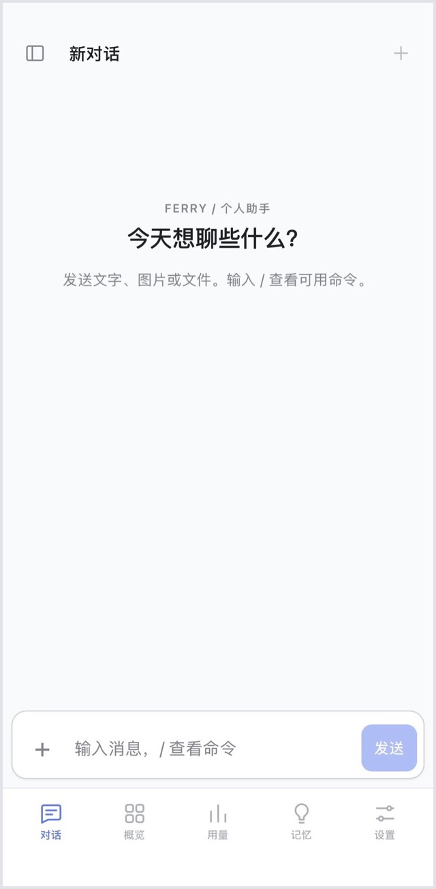
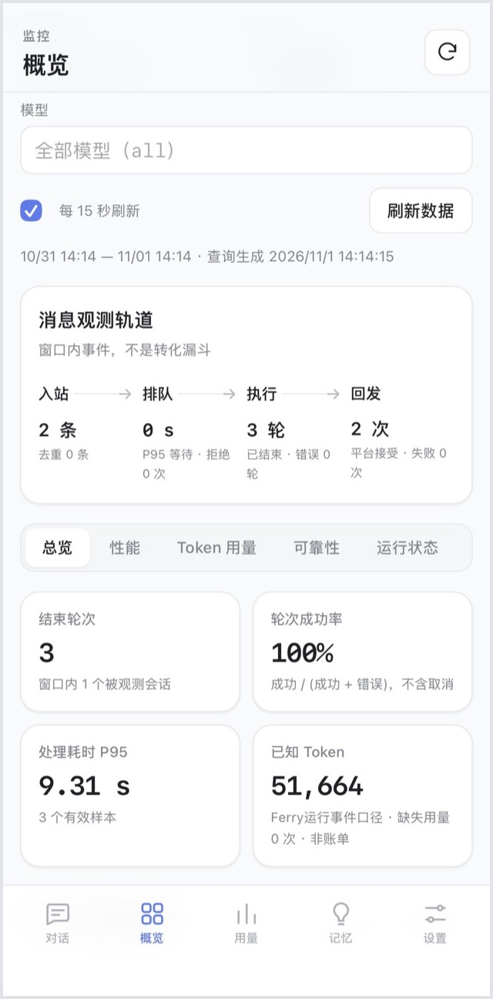
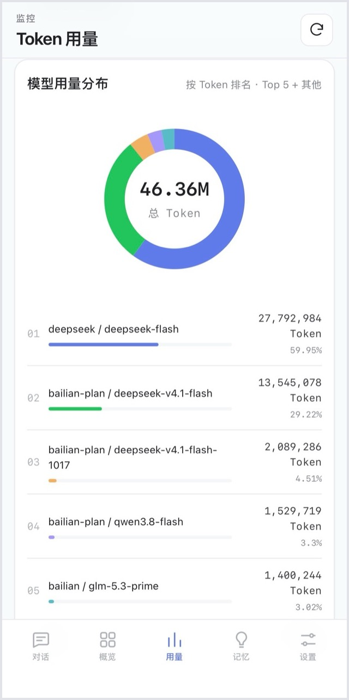
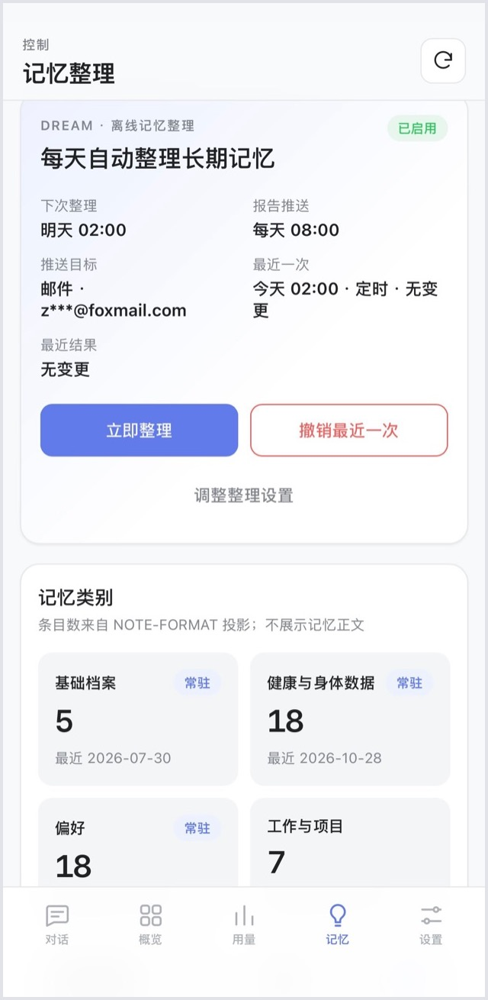
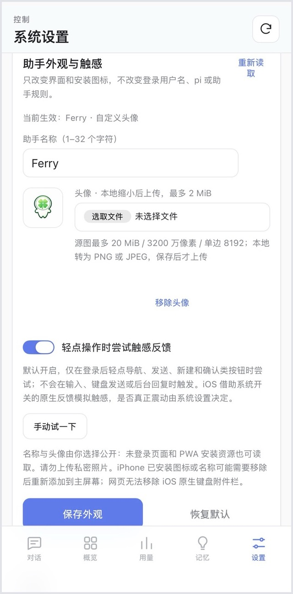
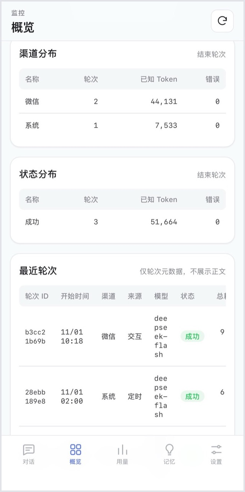
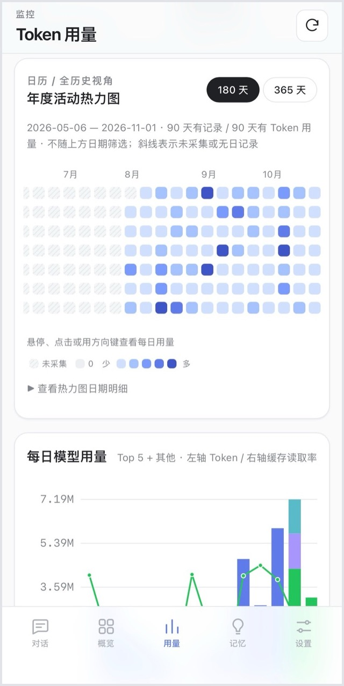
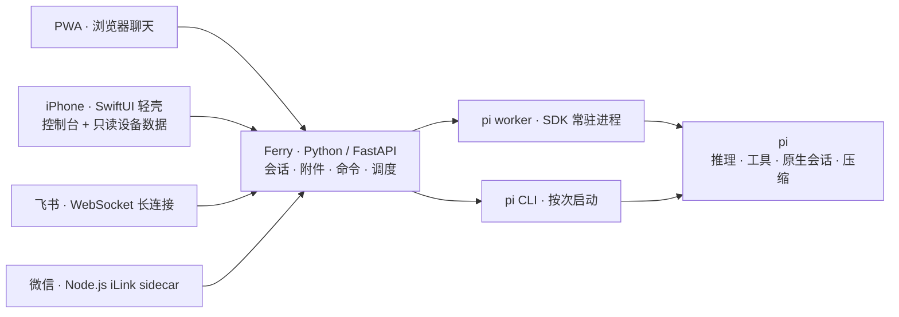

# Ferry

> 能力归 pi，编排归 Ferry

Ferry 是个人使用的 pi 桥接服务：从 PWA、iPhone、飞书或微信发消息，由本机 pi 处理，回复送回原渠道。
推理、工具调用、原生会话和上下文压缩交给 pi；Ferry 负责会话映射、消息收发、附件、命令、调度和进程管理，每轮注入本地规则、长期记忆与当前时间。
面向单实例部署，以本地文件持久化，不引入数据库或 Redis，也不另造一套模型历史或推理引擎。

## 界面

PWA 与 iPhone 共用一个控制台，底部五个页签覆盖聊天、观测与设置——不只是只读图表。

| 对话 | 概览 | 用量 | 记忆 | 设置 |
|:--:|:--:|:--:|:--:|:--:|
|  |  |  |  |  |
| <sub>流式正文 · 工具活动</sub> | <sub>入站到回发 · 轮次指标</sub> | <sub>模型分布 · Top 5</sub> | <sub>Dream 状态 · 立即整理</sub> | <sub>外观 · 触感反馈</sub> |

再看两张明细页：轮次落到了哪个渠道、Token 又花在哪几天。

|  |  |
|:--:|:--:|
| <sub>渠道分布 · 状态分布 · 最近轮次</sub> | <sub>年度活动热力图 · 每日模型用量</sub> |

## 架构



SDK worker 和 CLI 是同一个 pi 后端的两种运行方式，不是两套智能体；默认走 CLI，可切换常驻 worker。
PWA 与控制台由独立的观测进程提供，聊天和控制请求转发到主服务。

## 能做什么

- **多端聊天**：PWA 流式正文与工具活动、飞书渐进式卡片；微信保持整段回复。
- **会话与取消**：PWA 支持多会话、新建、改名和历史查看；渠道会话隔离，IM 消息去重、排队，运行任务可停止。
- **图片与文件**：PWA 上传附件；飞书、微信接收图片与文件，图片交 pi 多模态处理，文件通知随下一条消息送入，并支持回传。
- **后台完成与恢复**：刷新、切换会话或断网不会重发提示词，服务端继续处理并可恢复结果；主服务重启会中断在途轮次，没有离线发送队列。
- **统一模型**：三渠道及 Web 每日任务共享模型和思考强度，控制台修改后从下一轮生效，不改变正在执行的轮次。
- **记忆与调度**：NOTE-FORMAT 长期记忆、Dream 离线整理与报告、一次性提醒、每日任务；配置邮件后也可投送报告和每日任务。
- **通知与外观**：用户授权后接收 PWA 回复、提醒和每日任务通知；可设置 App 名称、图标和外观，跟随系统明暗。
- **iPhone 轻壳**：`ios/` 内置 SwiftUI 工程，聊天、设置与任务仍走服务端，原生页面只做手动触发、只读的设备数据同步。

## 快速开始

以下命令在仓库根目录执行。推荐 Python 3.13+，另需 Git、Node.js ≥ 22.19 和 pi 1.2.0；常驻 worker 校验 pi 的准确版本。

```bash
npm install -g @earendil-works/pi-coding-agent@1.2.0
python3 -m venv .venv
.venv/bin/python -m pip install -r conf/requirements.txt

# 仅首次复制；已有配置不要覆盖
[ -f conf/.env ] || cp conf/.env.example conf/.env
```

编辑 `conf/.env`，配置模型服务凭证和 `PI_MODEL`，先确保 pi 本身可以调用模型。
使用飞书时填写 `FEISHU_APP_ID`、`FEISHU_APP_SECRET`，完成机器人权限和长连接事件订阅，见[渠道接入](docs/channels.md)。
模型注册表位于 `conf/pi/models.json`，启动时同步到 pi agent 目录，默认是 `~/.pi/agent/models.json`。

部分默认值如下；`PI_MODEL` 默认留空，使用时填注册表中的 `provider/model-id`：

```dotenv
PI_CLI_BIN=pi
PI_MODEL=
PI_THINKING=high
PI_PERSISTENT_ENABLED=false
PI_WORK_DIR=./runtime/codex-workdir/pi
PI_TIMEOUT_SECONDS=180
WEB_PUSH_ENABLED=false
```

常驻模式设 `PI_PERSISTENT_ENABLED=true`，配置 `PI_NODE_BIN` 和指向 pi 1.2.0 `dist/index.js` 绝对路径的 `PI_SDK_MODULE`；关闭后重启可退回 CLI。

### 启动服务与控制台

需要 PWA 或控制台时，先初始化独立凭证，再启动主服务，让两边读到相同的内部令牌：

```bash
./bin/server obs credentials        # 首次生成，已有文件不覆盖；妥善保存仅显示一次的密码
./bin/server obs credentials ensure # 老配置补齐用户名、控制与聊天令牌，不改密码
./bin/server start
./bin/server status
./bin/server obs start
./bin/server obs status
```

控制台默认入口为 `http://127.0.0.1:38080/observability/`，私有配置在 `conf/.env.observability`。
公开默认用户名是 `admin`，**它不是密码**；密码随机生成，仅保存哈希，没有默认密码。
`OBSERVABILITY_USER_DISPLAY_NAME` 控制聊天中的本人显示名，默认“我”；个性化名称只写本机私有配置。
已有部署保留自己的用户名、密码和令牌，不必重新生成。

微信需扫码登录，之后可独立管理 sidecar：

```bash
./bin/server wx login
./bin/server wx start
```

`./bin/server start` 会启动主服务，并尝试启动已登录的微信及已启用的观测服务。
总入口支持 `stop|restart|status`；微信用 `wx stop|restart|status`，控制台用 `obs stop|restart|status`。

### 部署与进程管理

`bin/run-app` 等托管入口与 Supervisor 模板含固定解释器、PATH 和工作目录，须按部署环境调整，并确认进程实际使用的 Python、Node 与 pi 版本；归档、生成图片等目录也要确认权限，已有部署不要随意移动 pi 工作目录和会话目录。

`bin/server` 检测到 Supervisor 后会代理管理命令；总入口的重启可能涉及整组服务，日常按模板名称更新单个进程，**不要整组重启**：

```bash
supervisorctl restart ferry-stack:ferry   # 仅主服务需要更新时
supervisorctl restart ferry-observability # 仅独立控制台需要更新时
```

补齐共用令牌后两边都要重新加载，微信无需因此重启。HTTPS、反向代理和完整托管说明见[运维文档](docs/RELIABILITY.md)；`/healthz` 只证明 HTTP 存活，不代表模型或渠道正常。

## iPhone 原生客户端

`ios/` 是可选的 iPhone 轻壳，最低 iOS 17，只支持 iPhone。聊天、设置和定时任务仍由服务端执行，原生页面只做手动触发的只读同步：最近 30 天活动/心率/体重/血氧、所选日历前后 30 天、所选提醒列表的未完成项与近 30 天完成项。不申请健康写入，不修改或删除设备上的日历与提醒，Apple 提醒不会自动变成 Ferry 定时任务。PWA 仍可独立使用，网页读不到健康库。

仓库只含源代码：没有 Apple 账号、Team ID、证书、provisioning profile、签名产物或已同步的数据；Bundle ID 默认 `app.ferry.ios`，签名信息由使用者在本机填写，不入库。健康数据需要 App ID 允许 HealthKit，免费 Personal Team 未必支持，必要时使用 Apple Developer Program 的 Team。

本机打包（macOS + Xcode，工程已自带共享 `Ferry` scheme，无第三方依赖）：

1. 克隆仓库，Xcode 打开 `ios/Ferry.xcodeproj`。
2. Xcode → Settings → Accounts 登录自己的 Apple ID。
3. App target → Signing & Capabilities：保持 Automatically manage signing，选择自己的 Team，把 `PRODUCT_BUNDLE_IDENTIFIER` 改成自己唯一的反向域名；测试 target 同样选择 Team。
4. 确认 HealthKit capability 与 `Ferry.entitlements` 一致，且未启用 Background Delivery；`Info.plist` 里健康只读、日历/提醒完整访问的说明文案保持存在。签名报 capability 不被 Team 支持时换 Team，不要删 entitlement 绕过。
5. 连接 iPhone（信任电脑，按提示开启开发者模式），选设备后 Product → Build，再 Run；首次运行可能需在 设置 → 通用 → VPN 与设备管理 信任开发者。
6. App 内填自己的 HTTPS 地址并登录控制台，逐项授权，先同步一项小样本核对记录、时间与单位，再扩大范围。

服务端要求 HTTPS、`OBSERVABILITY_COOKIE_SECURE=true`；设备副本默认落在 `DEVICE_DATA_STORE_DIR`（`runtime/server/device-data/`，0700/0600，与观测、聊天、memory 分离，不进入默认 pi 上下文）。反向代理按 `conf/nginx-observability.locations.conf` 为 `/api/observability/v1/device-data/` 放行 256KiB，并屏蔽 `/internal/device-data/`。文件权限不是磁盘加密，备份与同机其他进程仍以信任部署主机为前提。

仓库不提供预签名 App 或 TestFlight 包，也无法替代真机验证：模拟器构建不覆盖健康授权、事件权限和签名限制。数据范围、接口、验收清单见 [iOS 文档](docs/ios.md)。

## 配置与本地规则

完整配置见 [conf/.env.example](conf/.env.example)。主服务读取 `conf/.env`，控制台私有项放在 `conf/.env.observability`。

- `PI_MODEL`、`PI_THINKING` 统一用于 PWA、飞书、微信及 Web 每日任务。直接改环境配置需重启；控制台修改从下一轮生效。
- 控制台选择持久化到 `runtime/server/console-settings.json`，优先于环境配置；“恢复默认”回到环境配置值。
- 旧 `WEB_PI_MODEL`、`WEB_PI_THINKING` 已弃用，残留配置不再生效；Dream 可用 `DREAM_MODEL` 单独指定模型。
- 模型、思考和调度等系统设置只接受白名单选项；聊天输入、会话名称与 App 外观有各自的编辑入口。
- `rules/system.md` 与 `rules/admin.md` 都是本地私有规则，保留在本机并由 Git 忽略，不随源码分发；新克隆可按需自行建立，缺失时跳过，`system.md` 缺失会告警但不阻止运行。
- 规则每轮重读，经 pi 的 system prompt 注入；`rules/dream.md` 仍为公共整理规则，只用于 Dream，不注入日常聊天。
- 从旧版本升级前先备份本机规则：Git 更新可能删除原先被跟踪的 `system.md`，升级后恢复到同名忽略路径。

## 记忆与定时任务

长期记忆保存在 `memory/`，采用 NOTE-FORMAT：有键和日期的事实条目、上下文元数据及归档区；可明确要求记住内容，常驻类别按配置注入，变更保存在本地记忆快照仓。

Dream 默认开启，每天 `02:00` 读取聊天增量，`08:00` 发送整理报告，时区由 `FERRY_TIMEZONE` 决定，默认 `Asia/Shanghai`。
“离线整理”指不占用对话 worker 的后台任务，仍会调用模型服务，不代表断网运行。
模型提出变更，Python 校验证据与敏感内容后才落盘；报告目标由 `DREAM_NOTIFY` 配置，留空不主动推送。
控制台可调整时间、目标或立即整理；手动命令、撤销与格式说明见[记忆文档](docs/memory.md)。

提醒和每日任务持久化并在重启后恢复。PWA 的结果保存在对应会话，即使没有通知权限也可查看。
通知需服务端启用 `WEB_PUSH_ENABLED`、配置有效的 `WEB_PUSH_CONTACT`，再由用户主动授权；锁屏通知不带聊天正文。
iPhone 需要 HTTPS 和主屏幕安装；原生键盘、系统推送、触感及图标更新差异仍需目标真机确认，不能以桌面模拟代替。

## 常用对话命令

| 命令 | 用途 |
|---|---|
| `/help`、`/skills` | 当前渠道帮助、本机项目技能 |
| `/new`、`/reset` | 开始新上下文，清理附件通知与 pi 映射，不删除旧 transcript |
| `/stop` | 取消当前任务；IM 同时清空排队消息 |
| `/remind 10m 喝水` | 一次性提醒，支持 `s/m/h/d`；飞书和 PWA 可用，微信暂不支持 |
| `/daily 08:00 今日安排` | 每日执行提示词；支持 `list`、`cancel <id>` |
| `/memory`、`/memory undo` | 查看记忆状态、撤销最近一次 Dream 变更 |
| `/dream`、`/dream all` | 立即整理当前对话或全部聊天对话 |

`/compact`、`/compress` 只说明上下文由 pi 原生管理，不手动压缩；具体支持范围以渠道 `/help` 为准。

## 监控、隐私与备份

运行监控统计轮次、耗时、Token、工具状态和回发结果，不采集聊天正文、思考、工具参数或结果。
pi 历史用量只读扫描 transcript 的 usage 元数据，支持趋势、热力图与模型明细；与实时运行埋点是两本账，不能相加。
在私有观测配置开启 `OBSERVABILITY_PI_USAGE_ENABLED=true` 后，可用 `./bin/server obs sync` 手动导入，观测进程重启后持续同步。

**监控无正文，不等于整个系统不保存内容。** PWA 聊天存储、附件、pi transcript、记忆和 Dream 整理记录都可能包含私人内容。
pi 1.2.0 还会保存 system 消息快照，包括注入的规则、记忆和时间；模型请求按当前轮重新构建，并非把所有旧系统快照重复注入。
这些内容可能随请求交给所配置的模型服务；不要在规则或聊天中放入不愿发送的秘密。

对外访问使用 HTTPS，并设 `OBSERVABILITY_COOKIE_SECURE=true`；浏览器依赖登录 Cookie 与 CSRF 校验，内部接口不得公开代理。
只读、上报、控制和聊天令牌彼此独立。私有配置、规则、日志、运行数据和记忆正文不应提交到源码仓库。
备份需同时覆盖 pi transcript、会话映射、PWA 聊天与附件、记忆和调度状态；启用通知还需保存 VAPID 密钥及订阅。
模型会话不能只靠网页历史恢复；IM 队列和待通知附件状态是内存态，不保证重启保留。详见[安全要求](docs/SECURITY.md)与[运维说明](docs/RELIABILITY.md)。

## 项目与文档

`bin/` 管理进程，`conf/` 放配置示例与依赖，`lib/python/` 实现主服务、渠道与控制台，`lib/js/` 提供微信 sidecar 和 pi worker。
`rules/`、`skills/`、`memory/` 分别承载规则、项目技能与长期记忆；`runtime/` 和 `logs/` 保存本地状态与日志。

`tests/` 只保留在本地，不随仓库分发；克隆后没有测试套件，不提供直接运行 pytest 的步骤。
回归范围见[测试要点](docs/TEST.md)和[核心功能清单](docs/functional-tests.md)，真实渠道及 iPhone 体验需另行验收。

[文档索引](docs/index.md) · [功能清单](docs/PRODUCT.md) · [架构](docs/architecture.md) · [会话](docs/sessions.md) · [变更记录](docs/requirement-changes.md)

## 许可

MIT
